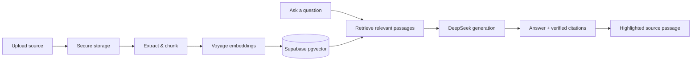

### NotesRAG

[](https://react.dev/)
[](https://www.typescriptlang.org/)
[](https://supabase.com/)
[](https://vercel.com/)

> A source-grounded study workspace that lets students ask questions about their own notes and inspect the exact passage behind every answer.

NotesRAG is designed around one principle: **retrieval decides what is true; generation only phrases it.** Upload a text-based PDF, Markdown file, or plain-text note, then study with answers that remain traceable to the original material.

### Highlights

| Capability                | What it means                                                                                                     |
| ------------------------- | ----------------------------------------------------------------------------------------------------------------- |
| **Private collections**   | Keep course materials, revision packs, and project notes organised by topic.                                      |
| **Grounded answers**      | Answers are generated only from retrieved passages in the active collection.                                      |
| **Claim-level citations** | Citation chips open the source and highlight the exact matching words, not just an entire chunk.                  |
| **Honest gaps**           | When the material does not support an answer, NotesRAG clearly says so without calling the language model.        |
| **Built for study flow**  | Ask follow-up questions, use starter prompts, solve option-based questions, and clear chats when beginning again. |
| **Responsive workspace**  | Chat and source material sit side-by-side on desktop; mobile uses focused, touch-friendly views.                  |

### Supported sources

| Format     | Status | Notes                                                                                     |
| ---------- | ------ | ----------------------------------------------------------------------------------------- |
| PDF        | ✓      | Text-based PDFs with selectable text. Scanned/image-only PDFs are intentionally rejected. |
| Markdown   | ✓      | `.md` files are indexed as source text.                                                   |
| Plain text | ✓      | `.txt` notes are indexed as source text.                                                  |

Files are limited to 20 MB in the MVP.

### How it works



PDFs are prepared in a Vercel Node function and rendered as page images with normalized word positions. This keeps PDF.js and native canvas work off the browser, avoiding WebKit compatibility failures while retaining precise source highlights.

### Product architecture

| Layer           | Responsibilities                                                                                             |
| --------------- | ------------------------------------------------------------------------------------------------------------ |
| **Web app**     | React, TypeScript, Vite, TanStack Query, responsive workspace UI, animations, and client-side session state. |
| **Supabase**    | Authentication, PostgreSQL with pgvector, Row Level Security, Storage, Realtime, and Edge Functions.         |
| **Vercel**      | Production frontend hosting and authenticated PDF preparation at `/api/process-pdf`.                         |
| **AI services** | Voyage for embeddings and DeepSeek for answer generation.                                                    |

### Trust and safety by design

- **Citation integrity is server-owned.** Retrieved chunk IDs are persisted in the `citations` join table; the UI never trusts free-form citation claims from a model.
- **Retrieval comes before generation.** Below-threshold retrieval returns the dedicated “not found in your notes” state and skips the model request.
- **RLS protects user data.** Collections, sources, chats, settings, and feedback are scoped to the authenticated user.
- **Cost controls run first.** A per-user daily message cap is checked before retrieval or model generation.
- **Secrets stay server-side.** Voyage and DeepSeek keys live only in Supabase Edge Function secrets. Vercel service credentials are used only by its serverless PDF function.

### Technical notes

- No OCR is included in the MVP. A PDF must have a selectable text layer to be indexed reliably.
- Source highlights resolve against the original words and their coordinates, enabling accurate PDF and text navigation.
- The PDF duplicate check uses file bytes; Markdown and text use normalized-content hashing.
- Edge Functions handle ingestion, retrieval validation, chat, usage metering, and account deletion.

### Development

```bash
npm install
npm run dev
```

Copy [`.env.example`](.env.example) to `.env` and provide only the public browser values:

```ini
VITE_SUPABASE_URL=https://YOUR_PROJECT_REF.supabase.co
VITE_SUPABASE_PUBLISHABLE_KEY=your_publishable_key
```

For a complete local PDF-processing environment, use `npx vercel dev` with the server-only values documented in `.env.example`. Never commit secrets or use a `VITE_` prefix for server credentials.

### Quality checks

```bash
npm run format:check
npm run typecheck
npm test
npm run build
```

### Deployment

1. Apply pending Supabase migrations with `npx supabase db push` after checking the migration plan.
2. Deploy the Supabase functions: `ingest-document`, `retrieve-chunks`, `chat`, `get-usage`, and `delete-account`.
3. Configure the Vercel environment variables listed in `.env.example`, including the server-only Supabase values used by PDF processing.
4. Configure Supabase Auth with the production site URL and allowed Vercel redirect URLs for magic-link and Google sign-in.
5. Push `main` to create the production Vercel deployment.

### License

This project is currently private and unlicensed.
